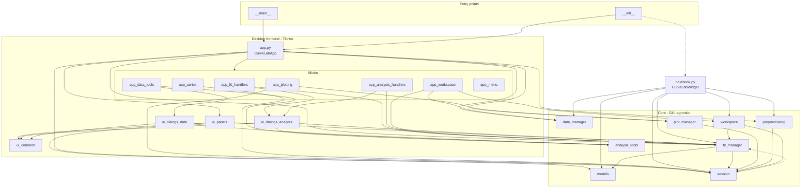
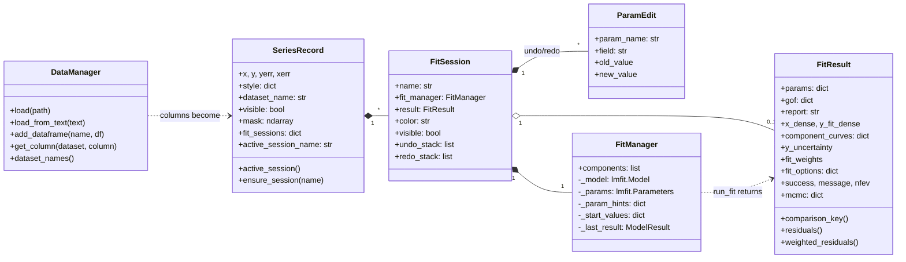
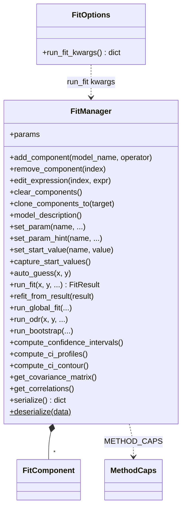
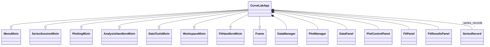
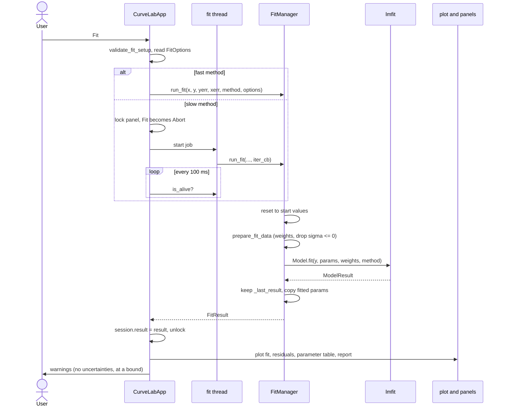
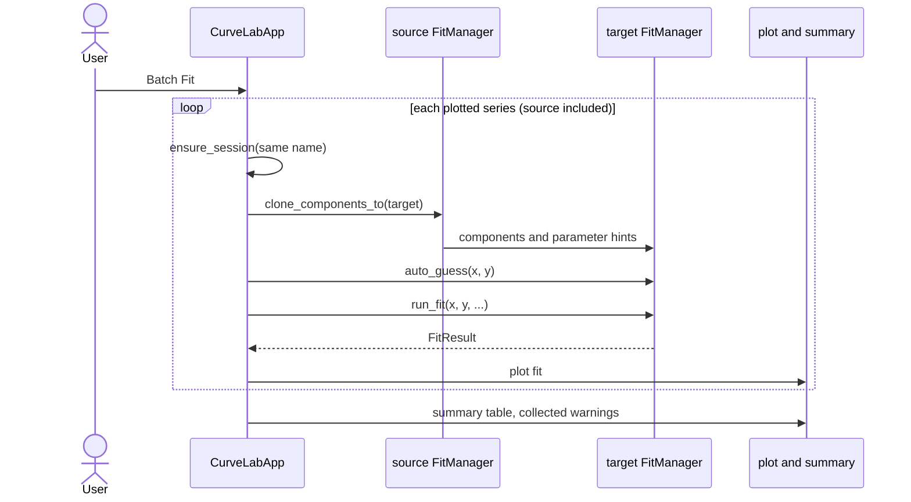
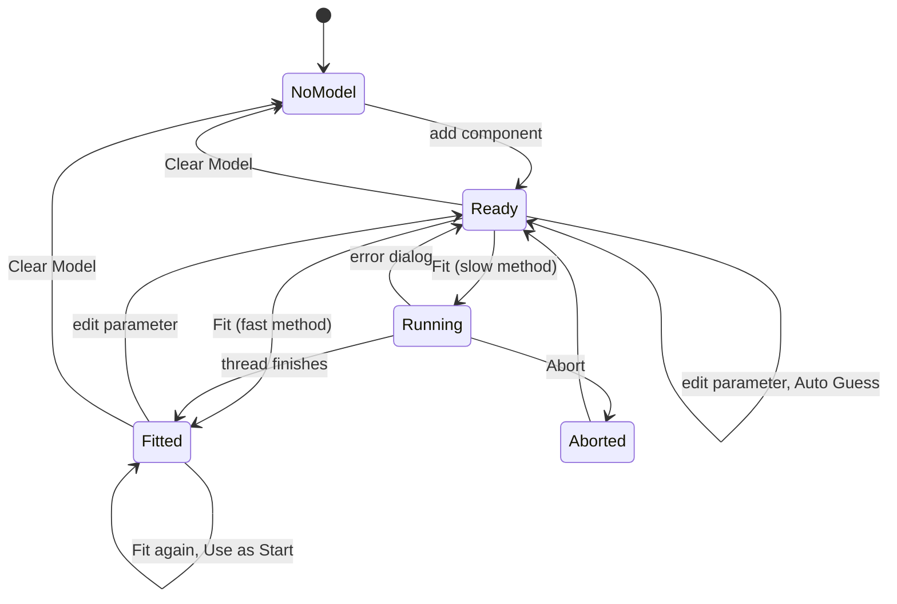

# CurveLab Architecture

How the code is organized, for contributors. The diagrams are Mermaid and
render on GitHub. They describe the code as of version 0.12.0.

## Modules

Arrows point from a module to the modules it imports. Dashed arrows are
imports done inside a function, to avoid a cycle or a heavy dependency.

The core modules never import a frontend, so the fitting engine can be used
from a script. `__init__` imports `app` unconditionally, so `import curvelab`
loads Tkinter even in a notebook.

## Data model

One `SeriesRecord` per plotted x/y pair, keyed by
`series_id = "dataset::x_col::y_col"`. Each series holds named fit sessions;
each session owns its own `FitManager` and the last `FitResult`.

## FitManager

The fitting engine wraps lmfit. Components are combined with `+ - * /`
into one composite model, with prefixed parameter names
(`gaussian1_center`). Parameter edits are stored twice: on the live
`Parameters`, and as hints that survive a model rebuild.

## Desktop application

`CurveLabApp` is a `ttk.Frame` assembled from mixins, one per area of the
UI. The mixins share state through `self`; they are split by topic, not
isolated from each other.

## Running a fit

Fast methods run on the Tk thread. The methods in `SLOW_METHODS` (emcee,
brute, the global optimizers) run on a background thread: the panel locks,
the Tk thread polls the thread, and Abort sets an event that an lmfit
`iter_cb` checks. ODR takes its own path through `run_odr`.

## Batch Fit

Batch Fit applies the active session's model to every plotted series, on
the Tk thread, with no abort.

## Fit lifecycle

The states of a session's fit as the desktop app sees them.

While a fit is Running, the controls that change the model or parameters
are disabled, and menu items and shortcuts refuse with a message. An
aborted fit is not shown, but it still leaves its parameters in the
`FitManager` (a known issue).
